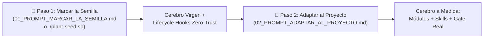

# 🧠 C://GHOST Brain — Metodología Universal de Gobernanza Cognitiva para Agentes de IA (`v3.0.0`)

**Un sistema operativo de memoria viva, seguridad *Zero-Trust*, divulgación progresiva de *Skills* y orquestación multi-agente diseñado para eliminar la «Amnesia del Chat» en cualquier proyecto y con cualquier IA.**

> Creado por **José Dugarte | Dugui - Metodología C-GHOST** · **Licencia:** Código y scripts bajo [**Apache 2.0**](./LICENSE) (con [`NOTICE`](./NOTICE) y blindaje de marca) · Manuales y doctrina bajo [**CC BY-SA 4.0**](./docs/LICENSE-DOCS) · Citación oficial en [`CITATION.cff`](./CITATION.cff).

---

## ⚡ Inicio Rápido en 60 Segundos (`v3.0 Universal`)

El núcleo **`v3.0`** es **100% agnóstico** (sin ataduras a lenguajes, nubes ni gestores externos) y funciona en **2 pasos limpios**:



1. **🌱 Marcar la Semilla** *(en cualquier carpeta vacía o proyecto existente)*:
   * **Sin scripts (copiar y pegar):** abre tu agente de IA y pega [`01_PROMPT_MARCAR_LA_SEMILLA.md`](./01_PROMPT_MARCAR_LA_SEMILLA.md).
   * **Por terminal en 1 segundo:**
     ```bash
     ./plant-seed.sh /ruta/a/tu-proyecto "Nombre de tu Proyecto"
     ```
2. **🦎 Adaptar el Cerebro a tu Proyecto:**
   * Pega [`02_PROMPT_ADAPTAR_AL_PROYECTO.md`](./02_PROMPT_ADAPTAR_AL_PROYECTO.md) en la conversación. Soporta automáticamente **descripción libre**, **entrevista guiada** o **escaneo de código existente (*Brownfield*)**.

---

## 📚 Manuales de Usuario Paso a Paso (De Cero a Operar Solo)

Cada generación del cerebro incluye su **propio manual completo paso a paso** para que cualquier usuario pueda instalarlo y operar con total autonomía:

| Versión / Edición | Ideal para... | Manual Paso a Paso | Release Git |
| :--- | :--- | :--- | :---: |
| **🌐 `v3.0` — Universal & Agnóstico** *(Recomendada)* | Cualquier lenguaje, nube o equipo; flujo en 2 Prompts + Hooks nativos (`SessionStart`, `PreToolUse`, `Stop` anti-bucle) + `run_workflow` / `Workspace: "share"`. | [**Manual v3.0 Universal**](docs/manuals/MANUAL_V3_UNIVERSAL.md) | `v3.0.0` (`main`) |
| **🤖 `v2.1` — Hermes × C://GHOST** | Usuarios de **Hermes Agent** que buscan **12 Protocolos**, **Pirámide de 5 Niveles \$0**, `init_c_ghost.py --migrate` (diff 3 vías), `preflight_check.sh`, `quota_tracker.py` y diagramas automáticos PNG/PDF. | [**Manual v2.1 Hermes**](docs/manuals/MANUAL_V2.1_HERMES.md) | `v2.1.0` + [`adapters/hermes/`](./adapters/hermes/) |
| **🌱 `v2.0` — Semilla del Edén** | Comprender la consolidación clásica de los **10 Protocolos**, ventana deslizante `STATUS.md ≤ 100` líneas y `.agents/skills/`. | [**Manual v2.0 Semilla del Edén**](docs/manuals/MANUAL_V2_SEMILLA_DEL_EDEN.md) | `v2.0.0` |
| **🎓 `v1.0` — Génesis (Principiantes)** | Personas con **cero conocimientos de programación** que desean dominar ChatGPT, Claude, Gemini o Antigravity con memoria persistente. | [**Manual v1.0 Principiantes**](docs/manuals/MANUAL_V1_GENESIS.md) · [Versión HTML interactiva](docs/manuals/Manual_Metodologia_CGHOST.html) | `v1.0.0` |

* **Fundamento teórico y empírico:** [Informe Científico de la Metodología](docs/informe_cientifico_metodologia.md) · [Línea Evolutiva Completa (`EVOLUTION.md`)](EVOLUTION.md).

---

## 🗂️ Estructura del Repositorio (`main` — `v3.0.0`)

```text
c-ghost-brain/
├── README.md                          # Portada y guía rápida
├── EVOLUTION.md                       # Evolución v1.0 → v2.0 → v2.1 → v3.0
├── CONTRIBUTING.md                    # Reglas DCO y guía para contribuyentes
├── CODE_OF_CONDUCT.md                 # Normas comunitarias
├── SECURITY.md                        # Política de divulgación responsable
├── CITATION.cff                       # Botón oficial "Cite this repository" (APA / BibTeX)
├── NOTICE                             # Atribución oficial obligatoria y aviso de marca
├── LICENSE                            # Apache License 2.0 (código, scripts y plantillas)
├── .github/                           # Plantillas de Issues/PRs + GitHub Actions CI
├── 01_PROMPT_MARCAR_LA_SEMILLA.md     # 🌱 Prompt 1 autocontenido (Semilla Virgen v3.0)
├── 02_PROMPT_ADAPTAR_AL_PROYECTO.md   # 🦎 Prompt 2 camaleónico (Adaptación al proyecto)
├── plant-seed.sh                      # ⚡ Sembrador CLI agnóstico v3.0
├── templates/                         # Plantillas base y Lifecycle Hooks v3.0
│   ├── AGENTS.universal.md
│   ├── STATUS.universal.md
│   ├── IDEAS.universal.md
│   ├── CHANGELOG.universal.md
│   ├── SKILL.universal.md
│   ├── hooks.universal.json
│   └── hooks/
│       ├── session-start.sh
│       ├── pre-tool-guard.sh
│       └── stop-gate.sh
├── adapters/
│   └── hermes/                        # 🔥 Adaptador Oficial Hermes × C://GHOST v2.1 (P0–P12)
│       ├── SOUL.example.md
│       └── skills/
│           ├── c-ghost-seed/          # init_c_ghost.py (--migrate), 4 scripts Nivel 0 y docs/
│           ├── opencode-cli/
│           └── antigravity-cli/
└── docs/
    ├── informe_cientifico_metodologia.md
    └── manuals/                       # 📖 Los 4 manuales paso a paso + diagramas
        ├── MANUAL_V1_GENESIS.md
        ├── Manual_Metodologia_CGHOST.html
        ├── MANUAL_V2_SEMILLA_DEL_EDEN.md
        ├── MANUAL_V2.1_HERMES.md
        ├── MANUAL_V3_UNIVERSAL.md
        └── assets/
```

---

## 🛡️ Pilares de Seguridad y Calidad Integrados
* **Zero-Trust por defecto:** Bloqueo mecánico de commits con `.env`, `.secrets/`, llaves SSH/TLS o credenciales JSON (sin bloquear `.env.example`).
* **Memoria viva acotada (`≤ 100` líneas):** Validada automáticamente en el cierre de cada turno mediante `stop-gate.sh` (con `continuationActive` anti-bucle) y en Hermes mediante `preflight_check.sh`.
* **100% auditable y sin dependencias ocultas:** Todos los sembradores y hooks funcionan exclusivamente con Bash POSIX + biblioteca estándar de Python 3.8+.

---

## 📜 Licencias y Atribución Oficial

* **Código, scripts, hooks y plantillas:** [**Apache License 2.0**](./LICENSE) *(protección explícita de marca en Sección 6 + conservación obligatoria de [`NOTICE`](./NOTICE))*.
* **Manuales, diagramas e informe científico (`docs/`):** [**Creative Commons CC BY-SA 4.0**](./docs/LICENSE-DOCS) *(abierto para uso personal, académico y comercial con atribución obligatoria y compartir igual)*.

Si utilizas o adaptas este cerebro en cualquier proyecto, incluye la atribución oficial:

```text
Basado en C://GHOST Brain — José Dugarte | Dugui - Metodología C-GHOST
```

También puedes copiar la cita académica en formato **APA** o **BibTeX** usando el botón **«Cite this repository»** de GitHub ([`CITATION.cff`](./CITATION.cff)).

