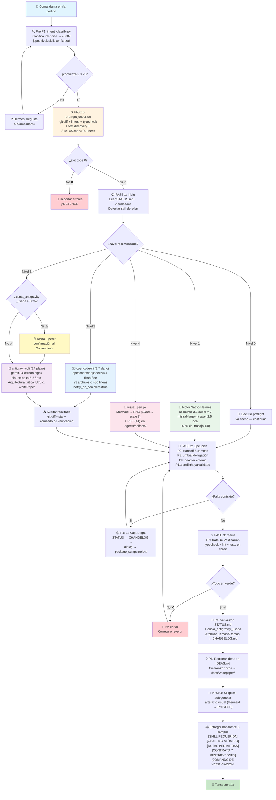
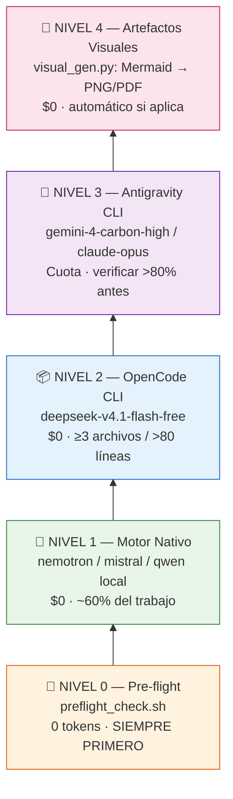
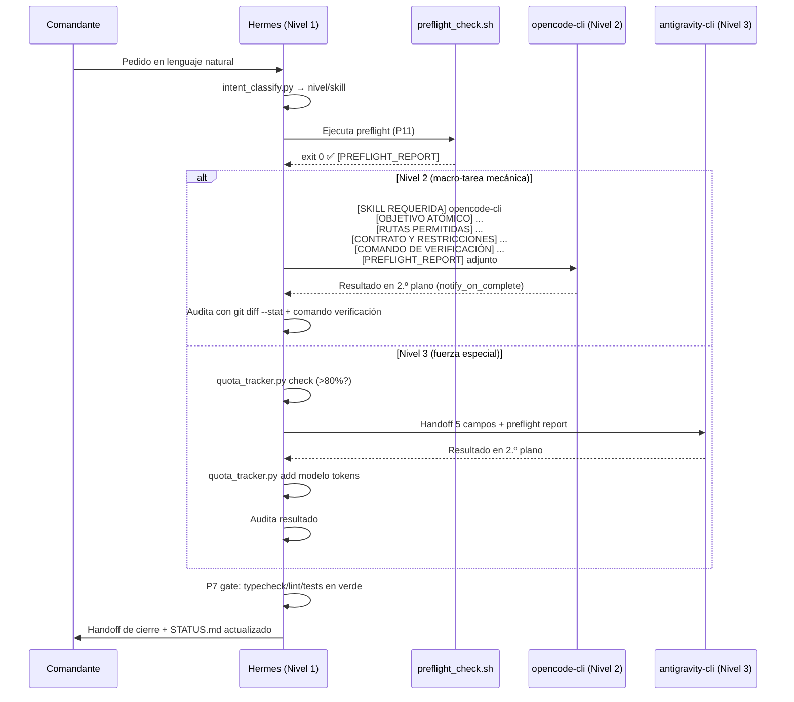
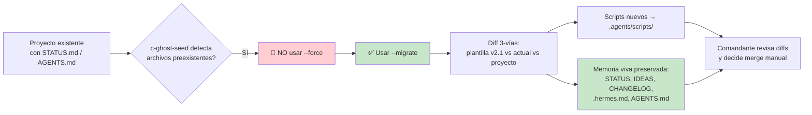

# DIAGRAMA DE FLUJO — C://GHOST v2.1

## Flujo completo de trabajo (4 Fases + 5 Niveles)

## Pirámide de 5 Niveles (vista lateral)

## Flujo de delegación con Handoff de 5 campos (P2 + P11)

## Migración segura v2.0 → v2.1 (P12)

