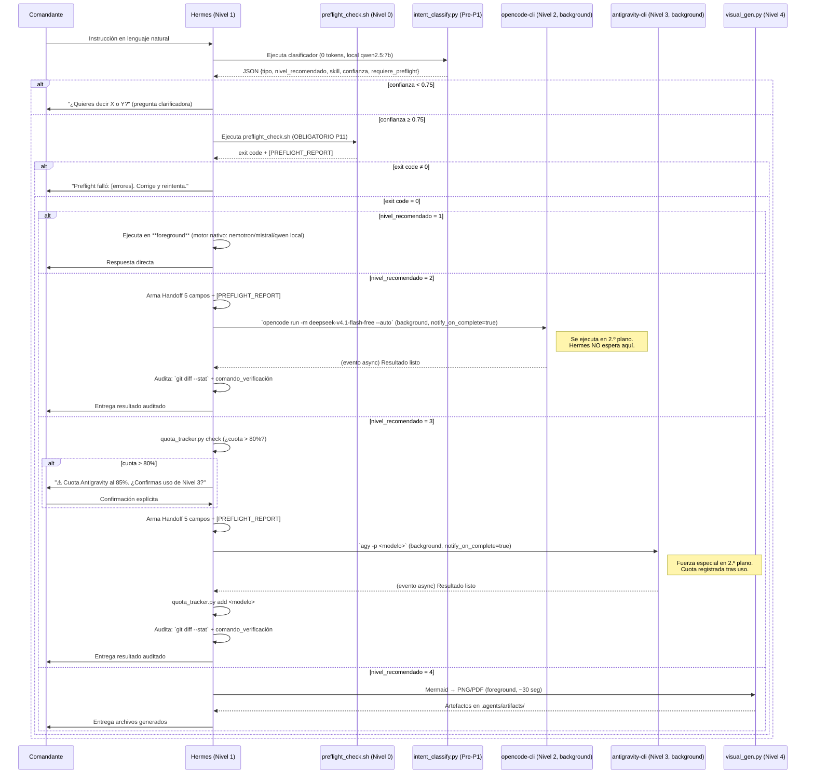

# MANUAL DE EJECUCIÓN DE INSTRUCCIONES — C://GHOST v2.1

**Versión:** 2.1.0 | **Audiencia:** Comandante (tú) | **Objetivo:** Entender qué pasa tras cada instrucción y cómo influir sin romper la automatización.

---

## 1. RESPUESTA DIRECTA A TU PREGUNTA

> **"¿Si pido explícitamente 'usa Antigravity CLI' u 'OpenCode CLI', también lo omites?"**

**Sí. No es una omisión — es el diseño.**

| Tu petición literal | Qué hace Hermes v2.1 |
|---------------------|----------------------|
| "usa Antigravity CLI para X" | Clasifica **X** (la intención), no la herramienta. Si X = "arquitectura zero-trust" → Nivel 3 (Antigravity). Si X = "crear un test" → Nivel 1/2 (nunca Antigravity). |
| "delega a OpenCode CLI esto" | Igual: clasifica **esto**. La mención de la CLI se ignora como "ruido de implementación". |
| "cambia a modelo Carbon" | Se ignora. El modelo es consecuencia del **nivel**, no una elección. |

**Regla de oro (P1 Zero-Command Routing):**
> *El Comandante define **QUÉ** quiere (intención/resultado). Hermes decide **CÓMO** (nivel, skill, modelo, background/foreground).*

---

## 2. QUÉ OCURRE AL RECIBIR UNA INSTRUCCIÓN (Flujo completo)



---

## 3. PUNTOS CLAVE DE EJECUCIÓN EN BACKGROUND

### Nivel 2 — OpenCode CLI (Macro-tareas mecánicas)
- **Cuándo:** `≥ 3 archivos` O `> 80 líneas` de cambio (scaffolding, refactors, tests, migraciones)
- **Cómo:** `opencode run -m opencode/deepseek-v4.1-flash-free --auto`
- **Background:** `notify_on_complete=true` → Hermes recibe evento async, NO bloquea
- **Auditoría post-ejecución:** `git diff --stat` + `comando_verificación` (del handoff)
- **Tú ves:** Resultado final auditado, no el proceso

### Nivel 3 — Antigravity CLI (Fuerzas especiales)
- **Cuándo:** Arquitectura crítica, Zero-Trust, UI/UX ejecutivo, WhitePapers, SQL/algoritmos complejos
- **Cómo:** `agy -p <modelo-específico>` (carbon-high, neon-medium, opus-5-5, etc.)
- **Background:** `notify_on_complete=true` → igual que Nivel 2
- **Gate previo:** `quota_tracker.py check` → si `cuota_antigravity_usada > 80%` → **pide confirmación**
- **Post-ejecución:** `quota_tracker.py add <modelo>` actualiza STATUS.md
- **Auditoría:** `git diff --stat` + `comando_verificación`
- **Tú ves:** Resultado final auditado + cuota actualizada

### Nivel 1 y 4 — Foreground (tú esperas la respuesta)
- **Nivel 1:** Motor nativo Hermes (chat, análisis, redacción) — respuesta streaming
- **Nivel 4:** `visual_gen.py` — genera PNG/PDF (~30 seg), tú ves progreso

---

## 4. CÓMO INFLUIR SIN ROMPER LA AUTOMATIZACIÓN

**No pidas herramientas. Pide RESULTADOS con contexto que active el nivel correcto.**

| Quieres esto... | Di esto (lenguaje natural) | Nivel que se activa | Por qué |
|-----------------|----------------------------|---------------------|---------|
| Razonamiento profundo gratis | "Analiza en profundidad los trade-offs de esta arquitectura, dame la lógica completa paso a paso" | 1 (nemotron-3-ultra) | Palabras "profundidad", "trade-offs", "lógica completa" → razonamiento |
| Arquitectura Zero-Trust real | "Diseña la arquitectura zero-trust: superficie de ataque, segmentación, políticas, amenazas y mitigaciones" | 3 (Carbon High) | "zero-trust", "superficie de ataque", "mitigaciones" → arquitectura crítica |
| UI/UX para directivos | "Redacta la spec de UX ejecutiva: journey, métricas, gobernanza, para presentar a stakeholders" | 3 (Claude Opus) | "ejecutiva", "stakeholders", "gobernanza" → redacción ejecutiva |
| Spec/WhitePaper técnico | "Genera el whitepaper técnico del sistema: arquitectura, decisiones, ADRs, para archivo" | 3 (Claude Opus) | "whitepaper", "ADRs", "archivo" → documentación arquitectónica |
| SQL/algoritmos complejos | "Optimiza esta query recursiva con CTEs, índices parciales y plan de ejecución" | 3 (Argon Medium) | "query recursiva", "CTEs", "plan de ejecución" → SQL avanzado |
| Scaffold / tests masivos | "Crea la estructura completa de tests para 5 módulos: auth, users, payments, notifications, audit" | 2 (OpenCode) | "estructura completa", "5 módulos", lista concreta → macro-tarea |
| Refactor masivo | "Migra todo el código legacy de callbacks a async/await en 12 archivos" | 2 (OpenCode) | "todo el código", "12 archivos", "migra" → macro-tarea |
| Consulta / chat diario | Cualquier pregunta normal, análisis, redacción, debugging | 1 (Nemotron Super VL) | Por defecto — 60% del trabajo |
| Diagrama de arquitectura | "Genera el diagrama de flujo de datos del sistema de pagos con Mermaid" | 4 (visual_gen) | "diagrama", "Mermaid", "flujo de datos" → artefacto visual |

### Frases que NO funcionan (se ignoran o degradan a Nivel 1)
| Frase | Qué pasa |
|-------|----------|
| "usa Antigravity CLI" | Ruido → clasifica tu intención real (la que sigue en la frase) |
| "delega a OpenCode" | Igual — la herramienta no es la intención |
| "cambia a modelo X" | Se ignora — el modelo es consecuencia del nivel |
| "haz esto en background" | Background es decisión de Hermes según nivel (2 y 3 siempre background) |
| "no uses preflight" | **Imposible** — P11 lo obliga siempre (exit 0 = requisito) |

---

## 5. ESTRUCTURA DEL HANDOFF (Lo que Hermes arma internamente)

Cuando delega a Nivel 2 o 3, **Hermes arma esto automáticamente** (tú no lo escribes):

```markdown
[SKILL REQUERIDA] opencode-cli | antigravity-cli
[OBJETIVO ATÓMICO] Crear tests unitarios para 5 módulos (auth, users, payments, notifications, audit) con cobertura ≥ 80%
[RUTAS PERMITIDAS] src/core/auth/, src/core/users/, src/core/payments/, src/core/notifications/, src/core/audit/, tests/
[CONTRATO Y RESTRICCIONES] 
- No modificar código de producción, solo crear tests/
- Usar pytest + pytest-asyncio + httpx
- Prohibido: credenciales, .env, datos reales, conexiones externas
- Patrón AAA (Arrange-Act-Assert) obligatorio
[COMANDO DE VERIFICACIÓN] pytest tests/ -v --cov=src --cov-report=term-missing
[PREFLIGHT_REPORT] ✅ preflight_check.sh exit 0 — git diff clean, ruff OK, mypy OK, pytest collect 47 tests, STATUS.md 67/100 líneas
```

**Regla P2 Zero-Trust:** Nunca pasan `.env`, credenciales, llaves privadas, datos reales de clientes.

---

## 6. CICLO DE VIDA DE UNA TAREA (Cuándo se cierra)

```
EJECUCIÓN → Auditoría (git diff + verificación) 
    → P7 Gate: typecheck + lint + tests en verde
    → SI TODO VERDE:
        → P4: Actualiza STATUS.md (nueva Tarea Activa o archiva a CHANGELOG)
        → P4: Actualiza cuota_antigravity_usada si Nivel 3
        → P6: Registra ideas en IDEAS.md
        → P9+/N4: Si generó arquitectura → visual_gen.py auto
        → Entrega Handoff de cierre (5 campos)
    → SI ALGO ROJO:
        → No cierra, corrige o revierte (git checkout)
        → Vuelve a EJECUCIÓN
```

---

## 7. CHEAT SHEET RÁPIDO PARA TI

| Situación | Qué hacer |
|-----------|-----------|
| Quieres arquitectura seria | Describe el problema + "arquitectura zero-trust / threat model / ADR" |
| Quieres muchos archivos/tests | Lista módulos/archivos concretos + "estructura completa / scaffold / migración" |
| Quieres doc ejecutiva | "para stakeholders / directivos / whitepaper / spec ejecutiva" |
| Quieres SQL/algoritmo duro | "query recursiva / CTE / plan ejecución / optimizar índice" |
| Quieres diagrama | "diagrama Mermaid / flujo de datos / arquitectura / secuencia" |
| Algo simple / chat | Habla normal — Nivel 1 automático |
| Preflight falla | Lee errores, corrige, reintenta (no hay atajo) |
| Cuota > 80% y necesitas Nivel 3 | Hermes te preguntará — di "confirmo" explícito |
| No sabes qué nivel | No intentes adivinar — describe **qué necesitas conseguir** |

---

## 8. REFERENCIA TÉCNICA (Scripts internos)

| Script | Ubicación | Qué hace | Cuándo se ejecuta |
|--------|-----------|----------|-------------------|
| `preflight_check.sh` | `.agents/scripts/` | Git diff + linters + typecheck + test collect + STATUS.md ≤100 líneas | **SIEMPRE PRIMERO** (P11) |
| `intent_classify.py` | `.agents/scripts/` | Clasifica intención → JSON {tipo, nivel, skill, confianza} | **Pre-P1** (cada instrucción) |
| `quota_tracker.py` | `.agents/scripts/` | Lee/escribe `cuota_antigravity_usada` en STATUS.md | Antes Nivel 3 (check) + tras Nivel 3 (add) |
| `visual_gen.py` | `.agents/scripts/` | Mermaid (stdin) → PNG 1920px scale 2 + PDF A4 | Nivel 4 (cuando hay arquitectura/flujo) |

---

*Manual generado bajo C://GHOST v2.1 — Protocolo 6 (WhitePaper sincronizado).*
*Para implementar: `python3 scripts/init_c_ghost.py --dir /proyecto --name "X" --migrate`*