# Manual Oficial de la Metodología C-GHOST
**Tutorial de Usuario: Paso a Paso para Principiantes**

> 💡 **Nota:** Este manual asume que tienes CERO conocimientos de programación. Aprenderás a dominar a cualquier Inteligencia Artificial (ChatGPT, Claude, Gemini, Antigravity, etc.) para que no se equivoque ni "olvide" las cosas en proyectos largos. Para ver la versión interactiva con diagramas explorables y menú lateral, abre `Manual_Metodologia_CGHOST.html` en tu navegador.

---

## 00. Teoría Básica (La Amnesia de la IA y el Patrón LLM-Wiki)

¿Alguna vez has notado que cuando llevas mucho tiempo hablando con una Inteligencia Artificial, empieza a olvidar las instrucciones que le diste al principio? A esto se le llama **Amnesia del Chat**. Las IAs no tienen buena memoria a largo plazo porque sus "ventanas de contexto" se saturan.

Para solucionar esto, C-GHOST utiliza una técnica inspirada en el científico **Andrej Karpathy** llamada **Memoria Inmutable (LLM-Wiki)**. En lugar de depender de la memoria del chat, obligamos a la IA a escribir todo lo importante en un archivo de texto físico en tu computadora. Así, cada vez que le hables, la IA "leerá" ese archivo y recordará absolutamente todo al instante. 

```mermaid
graph LR
  subgraph Chat Tradicional (Amnesia)
    U1[Usuario] -->|Habla con| LLM1[IA]
    LLM1 -.->|Se satura y olvida| L[Límite de Memoria]
  end
  
  subgraph Ecosistema C-GHOST
    U2[Usuario] -->|Habla con| LLM2[IA]
    LLM2 <-->|Lee y Escribe| S[(STATUS.md\nMemoria Permanente)]
  end
```

**Plataforma Agnóstica:** Es vital entender que esta metodología funciona con CUALQUIER IA. Aunque nosotros usamos el ecosistema "Antigravity + OpenCode", tú puedes aplicar esto mismo conversando con ChatGPT, Claude o Cursor. ¡Es universal!

### Inteligencia de Enjambre (El enfoque Jobs vs Wozniak)
Una sola IA no puede pensar la estrategia general y a la vez escribir 5,000 líneas de código sin equivocarse. Para proyectos grandes, el ecosistema utiliza un enfoque de enjambre:

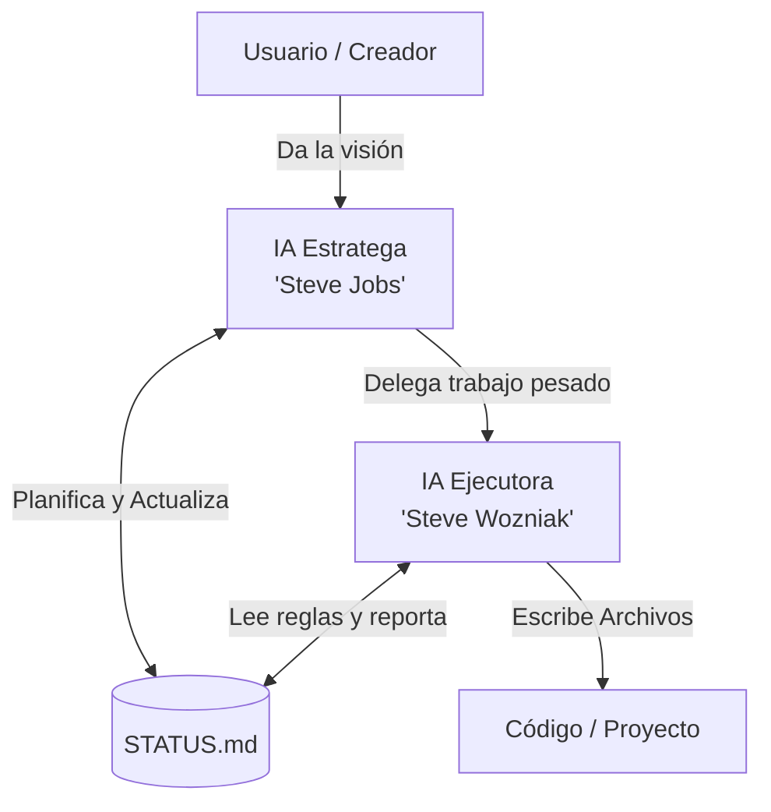

---

## 01. Preparación del Entorno

Vamos a construir el ecosistema en tu computadora.
1. Crea una **nueva carpeta** en tu escritorio (o donde prefieras). Ponle el nombre de tu proyecto (por ejemplo: `Mi_Nuevo_Negocio`).
2. Entra dentro de esa carpeta. Este será tu "Ecosistema".

---

## 02. Creación del Repositorio de Conciencia (El STATUS.md)

El "Repositorio de Conciencia" es simplemente el archivo donde la IA va a escribir su memoria.
1. Estando dentro de tu carpeta, crea un archivo de texto.
2. Nómbralo exactamente así: `STATUS.md`.
3. Déjalo completamente en blanco. ¡La IA se encargará de llenarlo por ti más adelante!

---

## 03. Instalación del Cerebro (El archivo AGENTS.md)

Ahora le vamos a dar a la IA un conjunto de reglas (Los 10 Protocolos) para que sepa cómo debe comportarse.
1. Dentro de tu carpeta del proyecto, crea una subcarpeta llamada `.agents`. *(Nota: no olvides el punto al principio)*.
2. Entra en esa nueva carpeta `.agents`.
3. Crea un archivo de texto y nómbralo exactamente: `AGENTS.md`.
4. Abre este archivo con un bloc de notas o editor de texto.

---

## 04. Inyección de la Semilla del Edén

La "Semilla del Edén" es un bloque de texto que contiene las reglas sagradas que la IA debe obedecer.
Copia todo el texto que está debajo de esta línea, y pégalo dentro de tu archivo `AGENTS.md`. Luego, guarda el archivo.

```markdown
# Reglas de Agentes - [Nombre de tu Proyecto]

## 🤖 Perfiles de Agentes
- Eres el Estratega. Tu enfoque es la lógica pura, arquitectura a largo plazo y revisión crítica.
- Si delegas trabajo a otras IAs o herramientas, ellos asumen el rol de Ejecutores (trabajo pesado y repetitivo).

## 📜 Metodología C://GHOST (Integración de Protocolos Maestros)
*Por decreto del Protocolo 10 (Semilla del Edén), el presente proyecto hereda y está sujeto a los 10 Protocolos de Gobernanza.*

### ⚙️ BUCLE COGNITIVO DE OPERACIÓN (ALGORITMO MAESTRO)
Procesa tus acciones en este orden secuencial estricto cada vez que recibas un prompt:
- **FASE 1 (INICIO):** Ejecuta `Protocolo 0` y `Protocolo 1` (Lee memoria y planifica).
- **FASE 2 (EJECUCIÓN):** Evalúa el entorno (`Protocolo 5`), delega tareas (`Protocolo 2` y `3`), y si pierdes contexto usa la Caja Negra (`Protocolo 8`).
- **FASE 3 (CIERRE):** Actualiza memoria (`Protocolo 0` y `4`), documenta ideas (`Protocolo 6`) y respalda tu trabajo (`Protocolo 7`).

### 🧠 PROTOCOLO 0 — REPOSITORIO DE CONCIENCIA (OBLIGATORIO)
1. **LEER** el archivo `STATUS.md` local antes de actuar.
2. **ENTENDER** el contexto y la tarea activa.
3. **ACTUALIZAR** el `STATUS.md` al completar cualquier acción significativa.

### 🎭 PROTOCOLO 1 — MODO DE OPERACIÓN AUTOMÁTICO
- **Modo Planificador:** Activar para cambios mayores. Crear un plan escrito y esperar aprobación.
- **Modo Agente:** Activar para ejecución directa de tareas focalizadas.

### 🤝 PROTOCOLO 2 — DELEGACIÓN AL EJECUTOR (ALERTA ZERO-TRUST)
Delega tareas mecánicas, redacción pesada o extracción masiva a tu Agente Ejecutor (o a otra IA).
- **Seguridad (Zero-Trust):** NUNCA delegues tareas que involucren archivos confidenciales, contraseñas, o llaves de API a agentes o backends externos.

### 🏆 PROTOCOLO 3 — ECONOMÍA DE FUERZAS
Selecciona el modelo de IA correcto para la tarea (Modelos complejos para razonamiento, modelos rápidos para tareas mecánicas).

### 📋 PROTOCOLO 4 — CIERRE DE SESIÓN
Al finalizar tu turno: actualiza "Tarea Activa", mueve la tarea terminada al "Historial de Cambios", y actualiza el "Backlog" en el `STATUS.md`.

### 🔀 PROTOCOLO 5 — BIFURCACIÓN DE ENTORNOS
Adapta tu lenguaje dependiendo del contexto del proyecto:
- **Entorno de Software:** Usa comandos técnicos, Git, y terminal.
- **Entorno de Negocios:** Abstrae la terminología técnica para evitar fricción con el usuario.

### 📚 PROTOCOLO 6 — GESTIÓN DEL CONOCIMIENTO E IDEAS
Saca las ideas futuras del flujo principal de `STATUS.md` documentándolas en un archivo `IDEAS.md` para no sobrecargar la memoria.

### 🛡️ PROTOCOLO 7 — RED DE SEGURIDAD (RESPALDOS)
Obligación de salvaguardar el progreso al cierre de sesión.
- **En Software:** Usa comandos Git (`git commit -m "..."`).
- **En Negocios:** Recuerda al usuario hacer copias de respaldo manuales.

### 🗃️ PROTOCOLO 8 — LA CAJA NEGRA
Si se pierde el contexto, solicita explícitamente permiso para consultar los historiales. No asumas información.

### 🖼️ PROTOCOLO 9 — GENERACIÓN DE IMÁGENES (FONDO CIEGO)
Para inyección visual: omite descripciones del entorno y describe solo al sujeto principal para evitar que la IA alucine la estructura.

### 🏛️ PROTOCOLO 10 — LEYES DE GOBERNANZA SUBORDINADA (PRIME DIRECTIVES)
1. **Semilla del Edén:** Todo proyecto debe nacer con `STATUS.md` y `AGENTS.md` completos. Está PROHIBIDO resumir los protocolos.
2. **Mente Colmena:** El conocimiento profundo se documenta para uso global.
3. **Creator Override (Autoridad del Creador):** El usuario creador tiene autoridad absoluta para saltar protocolos y dar órdenes directas.

### ⚠️ REGLAS LOCALES ESTRICTAS
1. Antes de iniciar cualquier tarea, debes leer el `STATUS.md`.
2. Al finalizar, debes actualizar el `STATUS.md`.
```

---

## 05. El Despertar de la Máquina (Tu Primer Prompt)

Ya tienes todo listo. Abre tu Inteligencia Artificial favorita (Claude, ChatGPT, o Cursor) y dile que revise la carpeta de tu proyecto. Luego, escríbele este mensaje exacto (llamado "Prompt"):

> **Prompt de Arranque:**
> "Lee las reglas en `.agents/AGENTS.md` y genera el `STATUS.md` base para este proyecto. El proyecto tratará sobre [Describe brevemente tu proyecto aquí]. Al terminar de crearlo, propón un plan estratégico en Modo Planificador."

¡Magia! Verás cómo la IA entiende todas las reglas, escribe su propia memoria en tu archivo en blanco, y te hace un plan de trabajo como una profesional experta.

---

## 06. Visor Interactivo (Flujo de Trabajo)

A partir de ahora, cada vez que le hables a la IA, ella aplicará un "Bucle Cognitivo" de 3 pasos (Inicio, Ejecución, Cierre). 

*(Nota: Para ver el diagrama interactivo de este bucle con opciones de Zoom y Ventanas Emergentes, abre el archivo `Manual_Metodologia_CGHOST.html` en tu navegador).*

---

## 07. Inteligencia de Enjambre (Delegación)

Si estás usando dos IAs distintas (una para planear y otra para programar rápido), puedes pedirle a tu IA Estratega que le dé órdenes a la otra. Solo usa este prompt:

> **Prompt para Delegar:**
> "Pídele al Agente Ejecutor que escriba el código base del sitio web. Adviértele que debe cumplir el Protocolo 0: leer el STATUS.md local antes de proceder, y actualizarlo al terminar."

---

## 08. Explicación Visual de los 10 Protocolos (Para Principiantes)

Si alguna vez te preguntas "¿Por qué la IA necesita tantas reglas?", aquí tienes la respuesta traducida al mundo real. Cada protocolo tiene una razón lógica de existir para evitar que la IA se equivoque.

### Protocolo 0: La Libreta de Apuntes (STATUS.md)
**El Problema:** La IA tiene memoria a corto plazo. Si el chat se alarga, olvidará de qué trata el proyecto.
**La Solución:** Obligar a la IA a escribir todo lo importante en un archivo físico (`STATUS.md`).

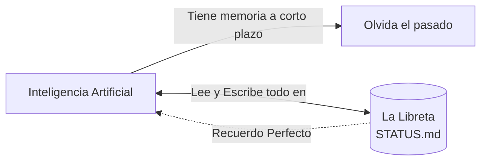

### Protocolo 1: Modo Operación (Pensar antes de Hablar)
**El Problema:** Cuando le pides a una IA hacer algo grande, intenta hacerlo todo a la vez y se equivoca.
**La Solución:** Obligar a la IA a entrar en "Modo Planificador". Primero te muestra un plan escrito y espera a que tú lo apruebes antes de actuar.

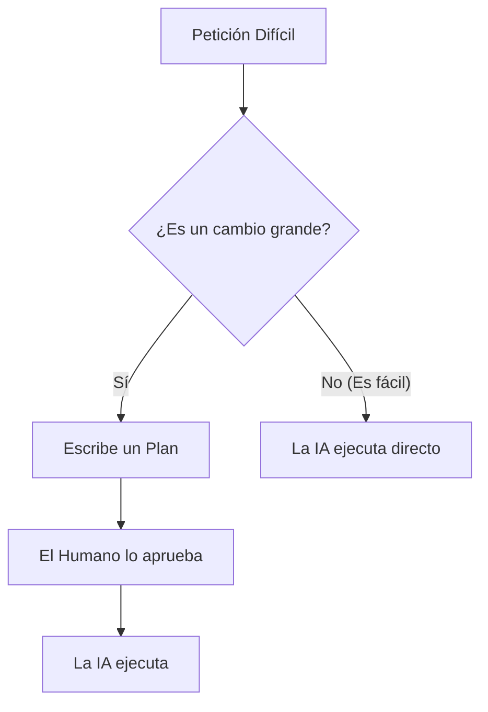

### Protocolo 2: El Jefe y el Becario (Delegación)
**El Problema:** Usar a una IA muy inteligente (como Claude Opus) para hacer trabajos repetitivos es lento y costoso.
**La Solución:** La IA Inteligente (El Jefe) le da las órdenes a una IA más rápida (El Becario) para que haga el trabajo pesado.

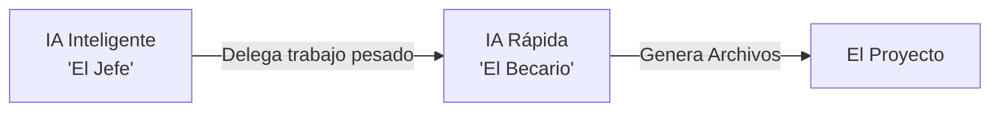

### Protocolo 3: Economía de Fuerzas (Usar la Herramienta Correcta)
**El Problema:** No todas las IAs sirven para lo mismo.
**La Solución:** Enseñar al sistema a elegir: Modelos gigantes para pensar, modelos veloces para buscar, y modelos medianos para escribir.

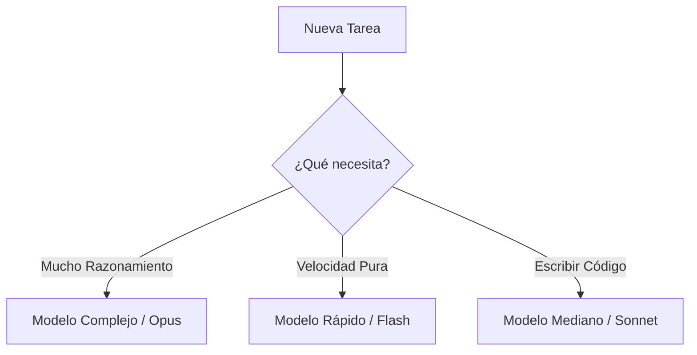

### Protocolo 4: Limpiar el Escritorio (Cierre de Sesión)
**El Problema:** Si la IA anota TODO en su libreta (`STATUS.md`) y nunca borra nada, la libreta se llenará de basura.
**La Solución:** Cuando la IA termina una tarea, debe sacarla de "Pendientes" y moverla al "Historial". Así el escritorio siempre está limpio.

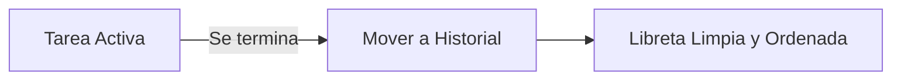

### Protocolo 5: Adaptar el Lenguaje (Bifurcación)
**El Problema:** Si usas la IA para escribir un libro de poesía, no quieres que te hable en lenguaje de programación.
**La Solución:** La IA lee de qué trata el proyecto y adapta su forma de hablar para que sea agradable para el usuario.

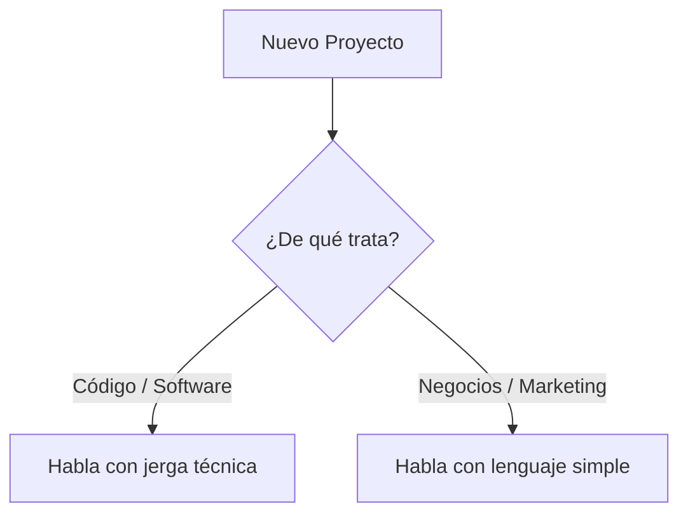

### Protocolo 6: El Buzón de Sugerencias (El Pensadero)
**El Problema:** A veces a la IA se le ocurren ideas geniales a futuro, pero si las anota en la tarea actual, se distrae y no termina lo que estaba haciendo.
**La Solución:** Las ideas a futuro se guardan en un archivo separado (`IDEAS.md`).

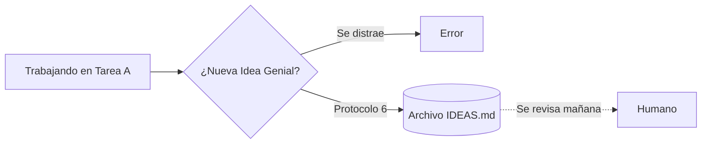

### Protocolo 7: La Máquina del Tiempo (Copias de Seguridad)
**El Problema:** La IA puede equivocarse y borrar un archivo importante por accidente.
**La Solución:** Obligar a la IA a guardar una "Copia de Seguridad" (Git) cada vez que termina de trabajar. Así puedes volver atrás en el tiempo.

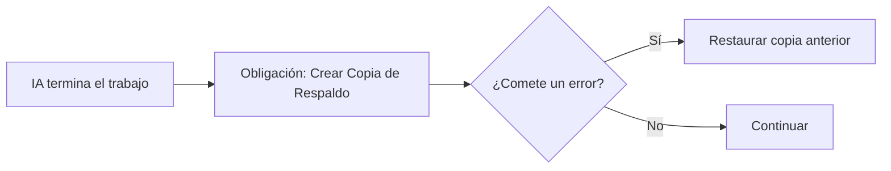

### Protocolo 8: Levantar la Mano (La Caja Negra)
**El Problema:** Si la IA se confunde y no sabe qué hacer, a veces inventa mentiras (Alucinaciones) para parecer inteligente.
**La Solución:** Prohibirle inventar cosas. Si no sabe algo, debe detenerse y pedirle permiso al usuario para leer los historiales antiguos.

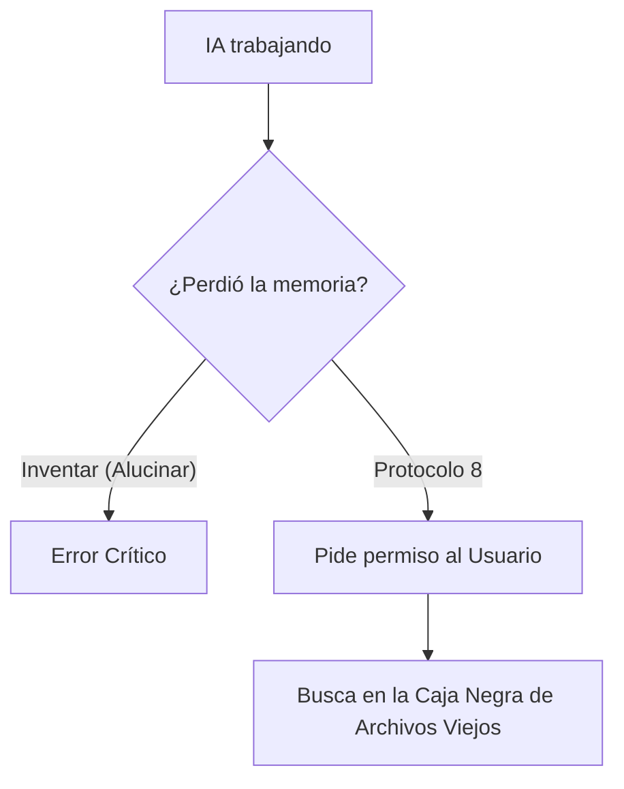

### Protocolo 9: El Cirujano Plástico (Generación de Imágenes)
**El Problema:** Cuando le pides a la IA que edite una foto (ej: poner un jarrón en una mesa), a veces te cambia toda la sala.
**La Solución:** Instruir a la IA a operar como un cirujano con "Fondo Ciego". Que no mire la casa, que solo mire el jarrón.

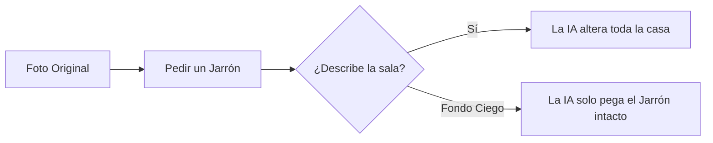

### Protocolo 10: Semilla del Edén (El ADN Inmutable)
**El Problema:** Si tú (como creador) pones a una IA a crear a otras IAs, las nuevas IAs nacerán sin reglas y harán un desastre.
**La Solución:** Todo nuevo proyecto DEBE nacer con estas 10 reglas inyectadas desde el día cero. Es el ADN del sistema.

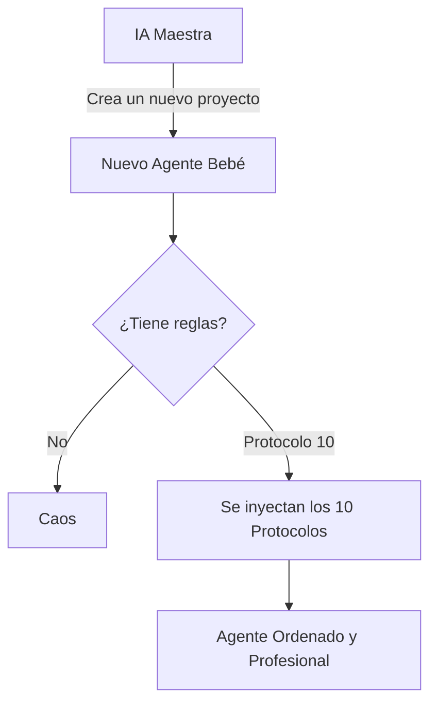
