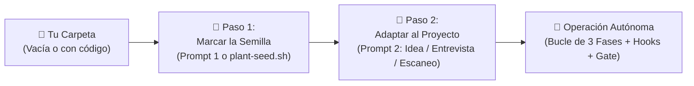

# 🌐 Manual de Usuario `C://GHOST v3.0` — Edición Universal y Agnóstica (De Cero a Operar Solo)

> **Audiencia:** Cualquier persona o equipo (desde un estudiante en su primer proyecto hasta un arquitecto en un monorepo multi-servicio) que quiera activar un cerebro operativo **100% libre de ataduras de stack, nube o gestor de tareas**, utilizando el flujo limpio en **2 Prompts** + **Lifecycle Hooks automáticos**.

---

## 1. Filosofía `v3.0`: Separar «La Semilla» de «Tu Proyecto»

El error más común con las plantillas de agentes es imponer desde el inicio un lenguaje o una nube específicos. **`C://GHOST v3.0 Universal`** divide el arranque en **dos pasos independientes**:



---

## 2. Prerrequisitos

* **Git** y **Python 3.8+** (`python3 --version`, sin paquetes `pip` adicionales).
* Tu agente de IA favorito con acceso a archivos del workspace (optimizado para **Antigravity v2.35+**, compatible con **Claude Code**, **Cursor**, **OpenCode CLI**, **Windsurf**, etc.).

---

## 3. Paso 1 — 🌱 Marcar la Semilla *(Kilómetro Cero)*

Elige la opción que prefieras dentro de tu proyecto:

### Opción A — Solo Copiar y Pegar *(Cero scripts, funciona en cualquier PC)*
1. Abre tu agente de IA dentro de la carpeta de tu proyecto.
2. Copia el bloque completo de [`01_PROMPT_MARCAR_LA_SEMILLA.md`](../../01_PROMPT_MARCAR_LA_SEMILLA.md) y envíalo como **primer mensaje**.
3. Espera a que el agente confirme:  
   `✅ Semilla C://GHOST v3.0 plantada y verificada. Listo para recibir el Prompt 2.`

### Opción B — Terminal en 1 Segundo *(Más rápido)*
```bash
./plant-seed.sh /ruta/a/tu-proyecto "Nombre de tu Proyecto"
```

### ¿Qué quedó instalado al terminar el Paso 1?
* `.agents/AGENTS.md` + enlace raíz `AGENTS.md` (los 10 Protocolos Universales en estado `[PENDIENTE_DE_ADAPTACION]`).
* `STATUS.md` (memoria viva en estado virgen `≤ 45` líneas), `IDEAS.md` y `CHANGELOG.md`.
* `.gitignore` endurecido *Zero-Trust* (`.env*`, `.secrets/`, `*.pem`, `*.key`, `credentials*.json`, llaves SSH).
* `.agents/hooks.json` + **3 Lifecycle Hooks ejecutables**:
  1. `session-start.sh`: inyecta telemetría de rama Git y conteo de líneas de `STATUS.md` al abrir sesión.
  2. `pre-tool-guard.sh`: bloquea automáticamente `git add` / `git commit` si intentan colar `.env` o llaves privadas (pero permite `.env.example`).
  3. `stop-gate.sh`: usa `continuationActive` para evitar bucles infinitos y exige compactar `STATUS.md` si supera las 100 líneas antes de cerrar el turno.

---

## 4. Paso 2 — 🦎 Adaptar el Cerebro al Proyecto *(Morfogénesis)*

Abre [`02_PROMPT_ADAPTAR_AL_PROYECTO.md`](../../02_PROMPT_ADAPTAR_AL_PROYECTO.md) y pégalo en el chat. Según tu situación, el cerebro mutará automáticamente en **uno de 3 modos**:

| Tu Situación | Cómo Usar el Prompt 2 | Qué Hará el Agente |
| :--- | :--- | :--- |
| **Modo A: Proyecto nuevo y tienes clara la idea** | Rellena los 5 campos al final del Prompt 2 con tu descripción libre. | Diseña solo los módulos reales que necesitas, redacta `docs/adr/ADR-001`, genera tus skills en `.agents/skills/` y fija tu comando de tests. |
| **Modo B: Proyecto nuevo pero aún no decides el stack** | Deja en blanco la sección inferior y envíalo tal cual. | Te hace una entrevista breve de 4–5 preguntas concretas sobre objetivo, stack, despliegue y seguridad antes de configurar el cerebro. |
| **Modo C: Repositorio que ya tiene código (*Brownfield*)** | Envíalo dentro de tu proyecto existente. | Lanza un subagente `research` de solo lectura que detecta tu lenguaje, frameworks y tests reales, y construye el cerebro sin tocar tu código. |

Al concluir el Paso 2, el agente te mostrará el resumen de tu arquitectura, las skills creadas y la primera tarea `F1-T01`, esperando tu orden **`Procede`**.

---

## 5. Cómo Operar Solo Día a Día (Guía Rápida de Autonomía)

Una vez adaptado el cerebro, no necesitas recordar comandos complejos ni repetir el contexto del proyecto:

1. **Al arrancar cada sesión:** Pide directamente tu siguiente objetivo (o escribe *"Lee `STATUS.md` y continuemos con la Tarea Activa"*). El agente activará `update_steps` para mostrarte el progreso paso a paso.
2. **Al pedir cambios grandes (≥ 3 archivos o varios módulos):** El cerebro aplicará automáticamente la **Regla del Umbral (Protocolo 3)** delegando con aislamiento físico **`Workspace: "share"`** (sin pisar archivos) o ejecutando un pipeline paralelo con **`run_workflow`**.
3. **Al diseñar una pantalla o arquitectura nueva:** Puedes pedir *"Muéstrame primero un prototipo interactivo con `generative_ui` antes de programar"* para validar el diseño visualmente dentro del chat.
4. **Al surgir una idea fuera de foco:** Dile *"Guarda eso en `IDEAS.md` (Protocolo 6) y sigamos"* para mantener velocidad sin perder la idea.
5. **Al cerrar una tarea:** Dile *"Supera el Gate de Verificación, actualiza `STATUS.md` y haz el commit atómico"*. El hook `stop-gate.sh` garantizará que `STATUS.md` nunca supere 100 líneas ni queden secretos en *staging*.
6. **Al terminar una fase larga:** Dile *"Abre una conversación nueva limpia para la Fase 2 usando `ConversationService`"*; el nuevo hilo arrancará ligero leyendo únicamente `STATUS.md` y `AGENTS.md`.

---

## 6. Verificación Manual Rápida de Salud del Cerebro

En cualquier momento puedes comprobar desde tu terminal que los hooks y la memoria están sanos:
```bash
wc -l STATUS.md                              # Debe ser <= 100 líneas
bash -n .agents/hooks/*.sh                   # Debe retornar sin errores
python3 -m json.tool .agents/hooks.json      # JSON válido
```
